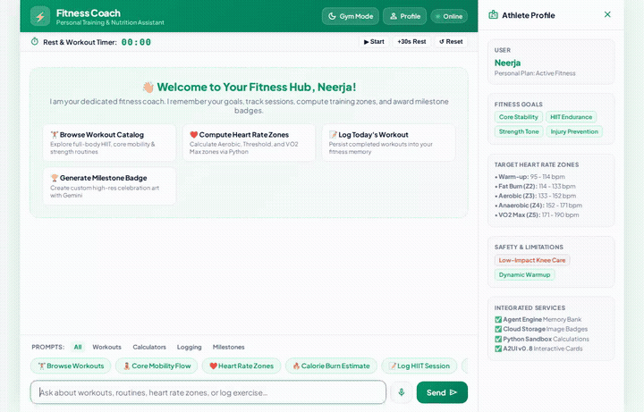

# 🏋️ Fitness Coach Agent

> A conversational fitness coach agent built on Google Cloud's Agent Platform using the Agent Development Kit (ADK) and `agents-cli`. The agent remembers user preferences across sessions, searches exercise databases and workout catalogs, performs training zone calculations, generates visuals and instructional exercise videos, and renders structured interactive UI using A2UI.

<div align="center">



</div>

---

## 🌟 What This Agent Does

Fitness Coach provides personalized fitness guidance and tracking through interactive dialogue and structured components:

1. **Cross-Session Long-Term Memory**:
   - Actively recalls user goals, injuries, dietary restrictions, and allergies across distinct chat sessions.
   - Automatically generates and saves new user insights at the end of each turn.

2. **Workout Catalog & Filtering**:
   - Queries a Firestore database of workout routines.
   - Filters routines by target muscle groups (Core, Full Body, Upper Body, Legs) and maximum duration.

3. **Public Exercise Lookup**:
   - Searches an open exercise database by body part, equipment type, or target muscle group.

4. **Target Heart Rate Zone Calculations**:
   - Computes individualized training intensity zones (Zones 1–5: recovery, fat burn, aerobic base, anaerobic threshold, neuromuscular power) using the Karvonen method.

5. **Local Fitness Spot Finder**:
   - Geocodes user addresses and discovers nearby gyms and fitness centers using the Google Maps Places API.

6. **Workout Logging**:
   - Persists completed workout sessions (routine, duration, notes, and timestamps) directly into Firestore.
   - Retrieves recent workout history on request.

7. **Media Generation**:
   - **Images**: Generates motivational workout illustrations and achievement milestone badges with `gemini-3.1-flash-lite-image` in the global region.
   - **Videos**: Generates short instructional movement demonstrations with `gemini-omni-flash-preview` in the global region.
   - Uploads generated media directly to a public Cloud Storage bucket and saves parts as ADK artifacts.

8. **Rich Agent-First UI (A2UI v0.8)**:
   - Formats responses as structured UI cards, columns, rows, text hierarchy, and media rather than plain text blocks.

9. **Secure Code Sandbox**:
   - Configured with `AgentEngineSandboxCodeExecutor` to perform precise calculations in an isolated Python sandbox.

---

## ☁️ Google Cloud Services & Tools Wired Up

The agent code in `app/agent.py` and `agents-cli-manifest.yaml` integrates directly with the following services:

| Component | Technology | Purpose |
|---|---|---|
| **Agent Reasoning Engine** | ADK + `agents-cli` | Core conversational loop powered by `gemini-3.6-flash` |
| **Long-Term Memory** | Vertex AI Memory Bank | Cross-conversation memory recall via `PreloadMemoryTool` and callback extraction |
| **Database** | Google Cloud Firestore | Structured storage for the workout catalog and workout activity logs |
| **Media Storage** | Google Cloud Storage (GCS) | Public hosting for generated workout illustrations and instructional videos |
| **Image Generation** | Gemini API (`gemini-3.1-flash-lite-image`) | On-demand creation of milestone badges and workout visuals |
| **Video Generation** | Gemini Omni (`gemini-omni-flash-preview`) | Short instructional exercise videos generated via the Interactions API |
| **Location Services** | Google Maps Places API | Address geocoding and nearby gym discovery |
| **Code Execution** | Vertex AI Agent Engine Sandbox | Python sandbox code executor (`AgentEngineSandboxCodeExecutor`) |
| **Rich Interface** | A2UI v0.8 | Structured cards, columns, rows, and responsive layouts |
| **Frontend Proxy** | FastAPI + A2A Protocol | Browser-to-Agent bridge communicating via the A2A protocol |

### Implemented Agent Tools

- `preload_memory`: Preloads cross-session user memories into the reasoning context.
- `list_workouts`: Lists and filters available routines from the Firestore workout catalog.
- `get_workout_details`: Retrieves comprehensive details for a specific workout ID.
- `search_public_exercises`: Queries public exercise databases by muscle, equipment, or exercise name.
- `calculate_heart_rate_zones`: Karvonen formula calculation for cardiovascular training zones.
- `geocode_address`: Geocodes user city/address coordinates via the Google Maps API.
- `find_nearby_places`: Finds nearby gyms or fitness facilities within a specified radius.
- `generate_workout_illustration`: Generates illustrative images with `gemini-3.1-flash-lite-image` and uploads them to Cloud Storage.
- `generate_workout_video`: Generates instructional exercise clips with `gemini-omni-flash-preview` and uploads them to Cloud Storage.
- `log_completed_workout`: Logs completed workout sessions with timestamps to Firestore.
- `get_recent_workout_logs`: Retrieves recent workout logs from Firestore.

---

## 📁 Repository Structure

```
fitness-coach/
├── app/
│   ├── agent.py                 # Core agent definition, tools, and callbacks
│   ├── a2ui_instruction.py      # A2UI system prompt schema and instructions
│   ├── a2ui_utils.py            # Model callback transforming A2UI payload
│   └── fast_api_app.py          # FastAPI application server
├── frontend/
│   ├── main.py                  # FastAPI A2A client proxy
│   ├── requirements.txt         # Frontend dependencies (a2a-sdk, fastapi, uvicorn)
│   └── static/
│       └── index.html           # Themed chat interface with A2UI renderer and gym mode
├── docs/
│   └── demo.gif                 # Looping demo recording of the interface
├── agents-cli-manifest.yaml     # Agent deployment manifest
└── pyproject.toml               # Project dependencies and tool configurations
```

---

## 🚀 Running the Project Locally

### Prerequisites

- Python 3.10+
- [`uv`](https://docs.astral.sh/uv/) package manager
- Google Cloud SDK (`gcloud`) authenticated with Application Default Credentials:
  ```bash
  gcloud auth application-default login
  ```

### 1. Run the Agent in ADK Web

To test the agent locally with the ADK developer UI and connected Memory Bank:

```bash
# Navigate to the project directory
cd fitness-coach

# Install dependencies
uv sync

# Launch ADK Web with agent hot-reloading
uv run adk web . --port 8080 --reload_agents
```

### 2. Run the Custom Web Frontend

To run the custom chat frontend locally connected to your deployed Agent Engine resource:

```bash
# Navigate to the frontend directory
cd fitness-coach/frontend

# Install dependencies into virtual environment
python3 -m venv .venv
source .venv/bin/activate
pip install -r requirements.txt

# Set the deployed Agent Engine resource name and directory
export AGENT_ENGINE_RESOURCE_NAME="projects/<PROJECT_ID>/locations/<REGION>/reasoningEngines/<ENGINE_ID>"
export AGENT_DIRECTORY="app"
export PORT=8080

# Start the frontend server
python main.py
```

---

## 🛠️ Deployment Instructions

### Deploy Agent to Agent Runtime

Deploy the agent to Google Cloud Agent Engine using `agents-cli`:

```bash
cd fitness-coach
agents-cli deploy
```

### Deploy Frontend to Cloud Run

Build and deploy the frontend container to Cloud Run pointing to your deployed agent:

```bash
cd fitness-coach/frontend

gcloud run deploy fitness-coach-frontend \
  --source . \
  --region us-east1 \
  --allow-unauthenticated \
  --set-env-vars AGENT_ENGINE_RESOURCE_NAME="projects/<PROJECT_ID>/locations/<REGION>/reasoningEngines/<ENGINE_ID>",AGENT_DIRECTORY="app"
```
